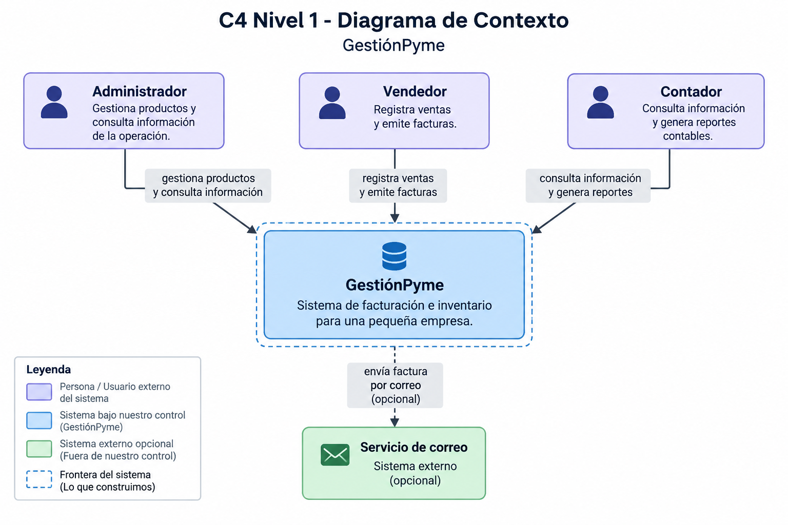
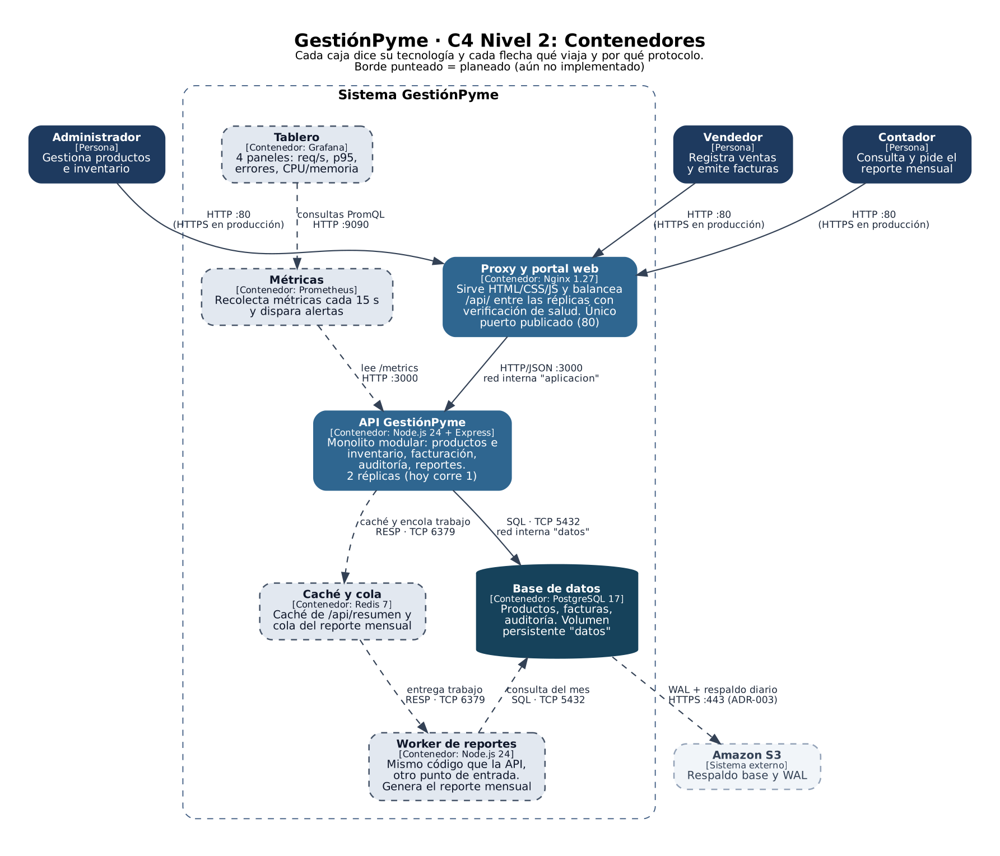
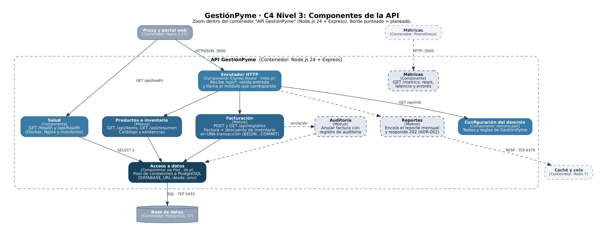

# Arquitectura · GestiónPyme (modelo C4)

| Nivel | Diagrama | Qué muestra |
|---|---|---|
| 1 · Contexto | [diagrama-contexto-nivel-1.png](diagrama-contexto-nivel-1.png) | Quién usa GestiónPyme (Administrador, Vendedor, Contador) y con qué sistemas externos habla |
| 2 · Contenedores | [diagrama-contenedores-nivel-2.png](diagrama-contenedores-nivel-2.png) | Las piezas que se despliegan, con su tecnología y el protocolo de cada flecha |
| 3 · Componentes | [diagrama-componentes-nivel-3.png](diagrama-componentes-nivel-3.png) | Los módulos internos de la API (monolito modular) |
| Despliegue y red | [red.png](red.png) · [red.md](red.md) | Diagrama de despliegue: VPC, subredes, rutas, grupo de seguridad, contenedores dentro de la EC2 y una regla por comunicación |

## Nivel 1 · Contexto

## Nivel 2 · Contenedores

| Contenedor | Tecnología | Responsabilidad | Estado |
|---|---|---|---|
| Proxy y portal web | Nginx 1.27 | Sirve el frontend (HTML, CSS y JS) y balancea `/api/` entre las réplicas con verificación de salud. Único puerto publicado | Implementado (balanceo y TLS planeados) |
| API GestiónPyme | Node.js 24 + Express | Monolito modular: productos e inventario, facturación, auditoría y reportes | Implementado (hoy 1 réplica; 2 planeadas) |
| Base de datos | PostgreSQL 17 | Productos y facturas, en el volumen persistente `datos` | Implementado |
| Caché y cola | Redis 7 | Caché de la consulta costosa `/api/resumen` (con medición antes y después) y cola del reporte mensual | Planeado ([ADR-002](../adr/ADR-002-reporte-en-worker.md)) |
| Worker de reportes | Node.js 24 (mismo código que la API) | Genera el reporte mensual fuera de la API | Planeado ([ADR-002](../adr/ADR-002-reporte-en-worker.md)) |
| Métricas | Prometheus | Recolecta métricas de la API cada 15 s y dispara la alerta (RNF-08) | Planeado (hito 3) |
| Tablero | Grafana | 4 paneles: solicitudes por segundo, p95, tasa de error y CPU/memoria | Planeado (hito 3) |

> **Nota sobre la versión anterior:** el primer diagrama de nivel 2 proponía Python/FastAPI y Quasar. Se actualizó a **Node.js + Express** y **HTML/JS servido por Nginx**, que es lo que realmente corre en el despliegue. Docker no aparece como caja: es la forma de desplegar, y eso se ve en el plan de red.

## Nivel 3 · Componentes de la API

| Componente | Archivo o endpoint | Estado |
|---|---|---|
| Enrutador HTTP | `src/api/src/index.js` (Express) | Implementado |
| Salud | `GET /health`, `GET /api/health` | Implementado |
| Métricas | `GET /metrics` para Prometheus | Planeado |
| Productos e inventario | `GET /api/items`, `GET /api/resumen` | Implementado |
| Facturación | `POST /api/registros` (en una transacción), `GET /api/registros` | Implementado |
| Configuración del dominio | `src/api/src/dominio.json`, `GET /api/info` | Implementado |
| Acceso a datos | `src/api/src/db.js` (pool de `pg`) | Implementado |
| Auditoría | Anular factura con registro de auditoría | Planeado |
| Reportes | Encola el reporte y responde `202` | Planeado ([ADR-002](../adr/ADR-002-reporte-en-worker.md)) |

## Fuentes editables

Los diagramas de nivel 2, nivel 3 y red se generan con Graphviz desde `fuentes/*.dot`. Para cambiar uno, se edita el `.dot` y se vuelve a generar el PNG (los comandos están al final de [red.md](red.md)).
