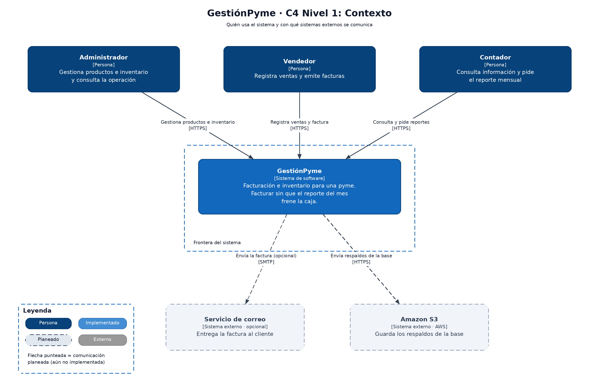
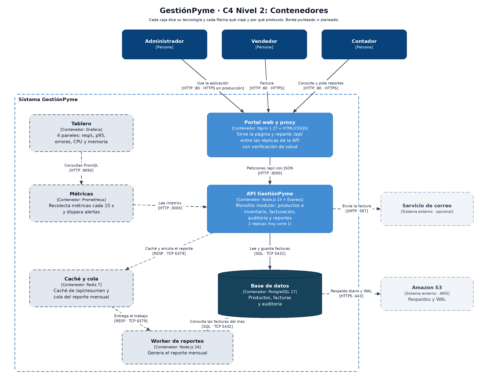
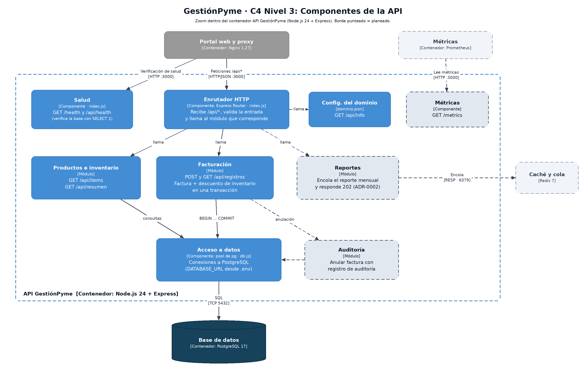
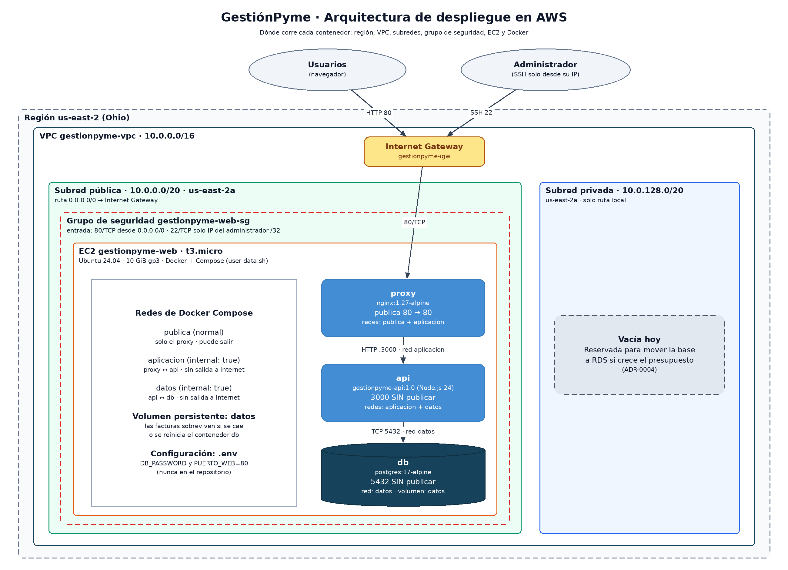
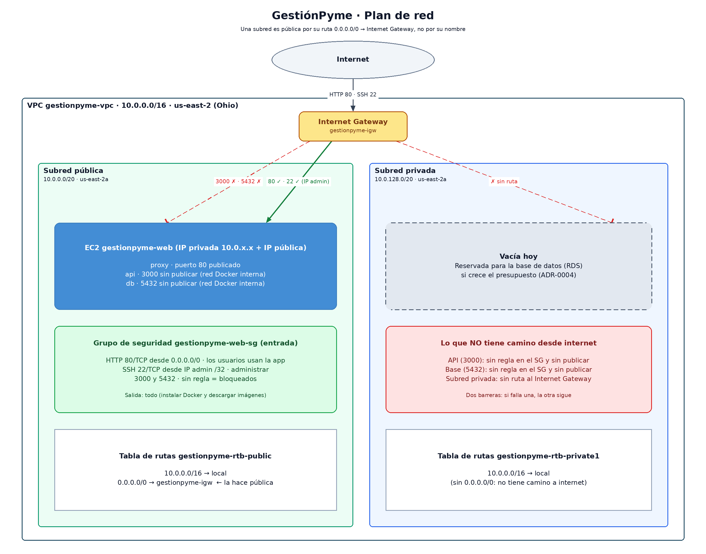

# Arquitectura · GestiónPyme

Todos los diagramas están hechos en **draw.io**: cada uno tiene su `.drawio` (editable) y al lado su `.png` exportado con una copia del diagrama incluida.

| Diagrama | Fuente | Imagen | Qué muestra |
|---|---|---|---|
| C4 nivel 1 · Contexto | [c1-contexto.drawio](c1-contexto.drawio) | [c1-contexto.png](c1-contexto.png) | Quién usa GestiónPyme y con qué sistemas externos se comunica |
| C4 nivel 2 · Contenedores | [c2-contenedores.drawio](c2-contenedores.drawio) | [c2-contenedores.png](c2-contenedores.png) | Las piezas del sistema, con su tecnología y el protocolo de cada flecha |
| C4 nivel 3 · Componentes | [c3-componentes.drawio](c3-componentes.drawio) | [c3-componentes.png](c3-componentes.png) | Los módulos internos de la API (monolito modular) |
| Despliegue | [despliegue.drawio](despliegue.drawio) | [despliegue.png](despliegue.png) | Región, VPC, subredes, grupo de seguridad, EC2 y los contenedores con sus puertos |
| Plan de red | [red.drawio](red.drawio) | [red.png](red.png) | Subredes, tablas de rutas, reglas y lo que no tiene camino desde internet. Justificación en [red.md](red.md) |

**Convención:** borde punteado = planeado (aún no implementado). Docker **no** aparece en el C2: va en el diagrama de despliegue.

## Nivel 1 · Contexto

## Nivel 2 · Contenedores

| Contenedor | Tecnología | Responsabilidad | Estado |
|---|---|---|---|
| Portal web y proxy | Nginx 1.27 + HTML/CSS/JS | Sirve la página y reparte `/api/` entre las réplicas con verificación de salud. Único puerto publicado | Implementado (balanceo entre réplicas y TLS planeados) |
| API GestiónPyme | Node.js 24 + Express | Monolito modular: productos e inventario, facturación, auditoría y reportes | Implementado (hoy 1 réplica; 2 planeadas) |
| Base de datos | PostgreSQL 17 | Productos y facturas, en el volumen persistente `datos` | Implementado |
| Caché y cola | Redis 7 | Caché de la consulta costosa `/api/resumen` y cola del reporte mensual | Planeado ([ADR-0002](../adr/0002-reporte-en-worker.md)) |
| Worker de reportes | Node.js 24 (mismo código que la API) | Genera el reporte mensual fuera de la API | Planeado ([ADR-0002](../adr/0002-reporte-en-worker.md)) |
| Métricas | Prometheus | Recolecta métricas cada 15 s y dispara la alerta (RNF-08) | Planeado |
| Tablero | Grafana | 4 paneles: solicitudes por segundo, p95, tasa de error y CPU/memoria | Planeado |

Sistemas externos: **Servicio de correo** (opcional, envía la factura) y **Amazon S3** (respaldos, [ADR-0003](../adr/0003-respaldo-wal-s3.md)).

> **Nota sobre la versión anterior:** el primer diagrama de nivel 2 proponía Python/FastAPI y Quasar. Se actualizó a **Node.js + Express** y **HTML/JS servido por Nginx**, que es lo que realmente corre en el despliegue.

## Nivel 3 · Componentes de la API

| Componente | Archivo o endpoint | Estado |
|---|---|---|
| Enrutador HTTP | `src/api/src/index.js` (Express) | Implementado |
| Salud | `GET /health`, `GET /api/health` | Implementado |
| Productos e inventario | `GET /api/items`, `GET /api/resumen` | Implementado |
| Facturación | `POST /api/registros` (en una transacción), `GET /api/registros` | Implementado |
| Configuración del dominio | `src/api/src/dominio.json`, `GET /api/info` | Implementado |
| Acceso a datos | `src/api/src/db.js` (pool de `pg`) | Implementado |
| Métricas | `GET /metrics` para Prometheus | Planeado |
| Auditoría | Anular factura con registro de auditoría | Planeado |
| Reportes | Encola el reporte y responde `202` | Planeado ([ADR-0002](../adr/0002-reporte-en-worker.md)) |

## Despliegue

## Plan de red

La justificación de cada regla está en [red.md](red.md).
