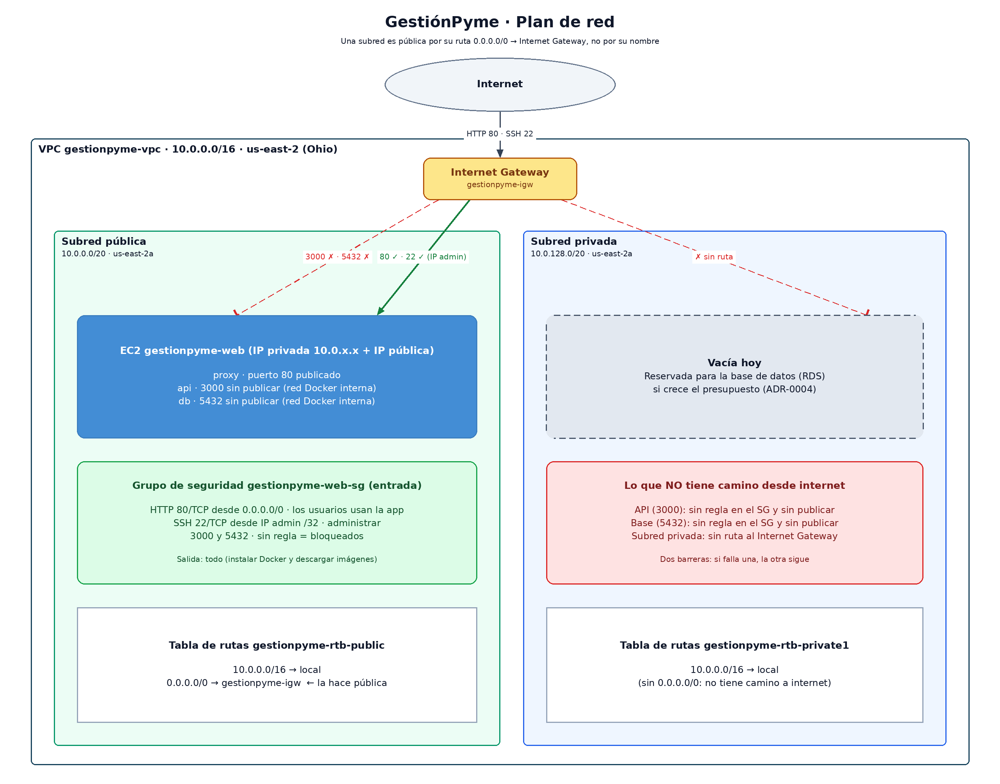

# Plan de red · GestiónPyme

Ver también el [diagrama de despliegue](despliegue.png), que muestra la EC2 y sus contenedores dentro de la VPC.

> **Regla del plan:** una subred es pública **por su ruta** `0.0.0.0/0 → Internet Gateway`, no por cómo se llama. Si el plan y la consola no coinciden, se corrige el plan.

## 1. VPC y subredes

| Recurso | Nombre | CIDR | Zona | Para qué |
|---|---|---|---|---|
| VPC | `gestionpyme-vpc` | `10.0.0.0/16` (65.536 IP) | us-east-2 (Ohio) | Red propia del proyecto, con espacio para crecer |
| Subred pública | `gestionpyme-subnet-public1-us-east-2a` | `10.0.0.0/20` (4.091 IP disponibles) | us-east-2a | **Solo** la EC2 con el proxy |
| Subred privada | `gestionpyme-subnet-private1-us-east-2a` | `10.0.128.0/20` | us-east-2a | Reservada para la base (RDS) si se migra ([ADR-0004](../adr/0004-despliegue-una-ec2-compose.md)) |
| Internet Gateway | `gestionpyme-igw` | — | — | Salida y entrada a internet, solo de la subred pública |
| NAT Gateway | **Ninguno** | — | — | Cobra por hora (unos 32 USD/mes); hoy no se necesita |

> **Región:** se usó **us-east-2 (Ohio)**, porque es la región habilitada en la cuenta del curso. El análisis de costos se hizo en us-east-1 con los mismos servicios.
> **CIDR de la subred privada:** es el que asigna por defecto el asistente *VPC y más* con 1 zona. El de la subred pública (`10.0.0.0/20`) se confirmó en la consola al lanzar la instancia.

## 2. Tablas de rutas

| Tabla | Asociada a | Destino | Objetivo | Efecto |
|---|---|---|---|---|
| `gestionpyme-rtb-public` | Subred pública | `10.0.0.0/16` | local | Tráfico dentro de la VPC |
| | | **`0.0.0.0/0`** | **`gestionpyme-igw`** | **Esto la hace pública** |
| `gestionpyme-rtb-private1` | Subred privada | `10.0.0.0/16` | local | Solo tráfico interno. **Sin camino a internet** |
| Tabla principal | (ninguna subred explícita) | `10.0.0.0/16` | local | La crea AWS sola con la VPC |

## 3. Grupo de seguridad `gestionpyme-web-sg`

Se llamó `gestionpyme-web-sg` y no `sg-gestionpyme-web` porque AWS no permite nombres que empiecen por `sg-` (ese prefijo está reservado para los identificadores).

**Reglas de entrada** (todo lo que no aparece está bloqueado):

| Tipo | Protocolo | Puerto | Origen | Justificación |
|---|---|---|---|---|
| HTTP | TCP | 80 | `0.0.0.0/0` | Los usuarios entran a la aplicación por el proxy |
| SSH | TCP | 22 | IP del administrador `/32` | Solo el equipo administra el servidor |
| — | — | **3000** | **Ninguno** | La API no debe existir para internet |
| — | — | **5432** | **Ninguno** | La base de datos no debe existir para internet |

**Reglas de salida:** todo el tráfico (la predeterminada). La instancia necesita salir a internet para instalar Docker y descargar imágenes.

## 4. Redes Docker dentro de la EC2

Las tres redes de Docker Compose repiten, dentro del servidor, las tres capas de una VPC:

| Red Docker | `internal` | Contenedores | Equivale a |
|---|---|---|---|
| `publica` | no | `proxy` | Subred pública |
| `aplicacion` | **sí** (sin salida a internet) | `proxy`, `api` | Subred privada de aplicación |
| `datos` | **sí** (sin salida a internet) | `api`, `db` | Subred privada de datos |

El `proxy` **no** está en la red `datos`, así que no puede hablar con la base aunque quisiera.

## 5. Una regla por comunicación

| # | Origen | Destino | Puerto / protocolo | ¿Permitido? | Justificación | Dónde se controla |
|---|---|---|---|---|---|---|
| 1 | Internet | `proxy` (Nginx) | 80 / HTTP | ✅ | Los usuarios usan la aplicación | Grupo de seguridad + `ports` del Compose |
| 2 | IP del administrador | EC2 | 22 / SSH | ✅ | Administrar el servidor | Grupo de seguridad (`/32`) |
| 3 | `proxy` | `api` | 3000 / HTTP-JSON | ✅ | Reenviar `/api/` a la API | Red Docker `aplicacion` |
| 4 | `api` | `db` | 5432 / SQL (TCP) | ✅ | Leer y guardar productos y facturas | Red Docker `datos` |
| 5 | Internet | `api` | 3000 | ❌ | La API no se expone | Sin regla en el SG **y** sin `ports` en el Compose |
| 6 | Internet | `db` | 5432 | ❌ | La base no se expone | Sin regla en el SG **y** sin `ports` en el Compose |
| 7 | `proxy` | `db` | 5432 | ❌ | El proxy no necesita la base | No comparten red Docker |
| 8 | `api` | Internet | cualquiera | ❌ | La API no necesita salir | Red `aplicacion` con `internal: true` |
| 9 | EC2 | Internet | 443 / HTTPS | ✅ | Instalar Docker y descargar imágenes | Regla de salida del SG + ruta al IGW |
| 10 | `db` | Amazon S3 | 443 / HTTPS | ⏳ Planeado | Respaldo y WAL ([ADR-0003](../adr/0003-respaldo-wal-s3.md)) | Rol de IAM de la instancia |

## 6. Las dos barreras

La API y la base están protegidas por **dos barreras independientes**:

1. **El grupo de seguridad** no abre el 3000 ni el 5432: AWS descarta el tráfico antes de que llegue al servidor.
2. **Docker no publica** esos puertos: aunque el tráfico llegara al servidor, no hay ningún proceso escuchando en la IP pública para el 3000 ni el 5432.

**¿Qué pasa si se quita solo una?**

- *Si alguien abre el 5432 en el grupo de seguridad,* igual no conecta, porque Docker no publica ese puerto.
- *Si alguien agrega `ports: "5432:5432"` al Compose,* AWS sigue bloqueando el tráfico en el grupo de seguridad.

Con las dos barreras, **un solo error de configuración no deja la base expuesta**. Es el primer control de seguridad del **RNF-05**, comprobado desde internet el 23-nov-2026 ([despliegue.md](../despliegue.md)).

## 7. Diagramas

Los diagramas están hechos en **draw.io**. Cada uno tiene su archivo `.drawio` (editable) y, al lado, el `.png` exportado con una copia del diagrama incluida:

| Diagrama | Fuente | Imagen |
|---|---|---|
| Plan de red | [red.drawio](red.drawio) | [red.png](red.png) |
| Arquitectura de despliegue | [despliegue.drawio](despliegue.drawio) | [despliegue.png](despliegue.png) |

Para editarlos: abrir el `.drawio` en [diagrams.net](https://app.diagrams.net) o con la extensión *Draw.io Integration* de VS Code y volver a exportar el PNG marcando **Include a copy of my diagram**.
