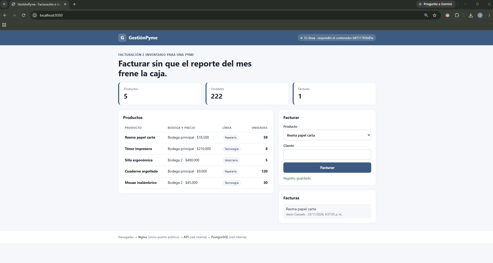
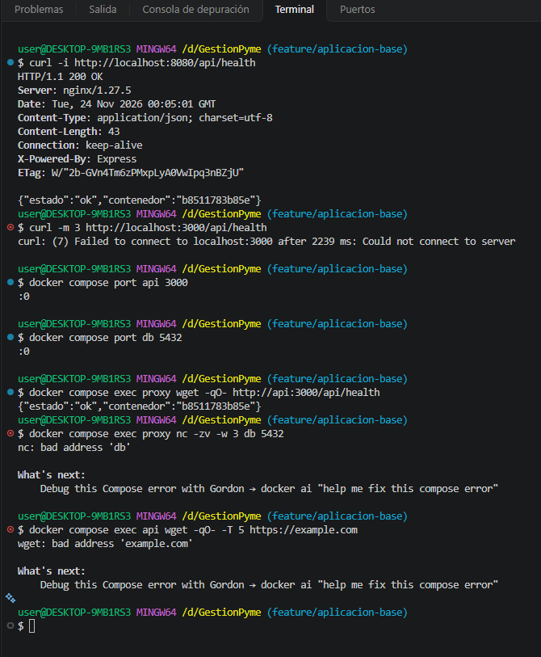
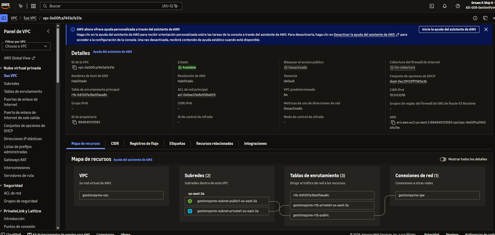
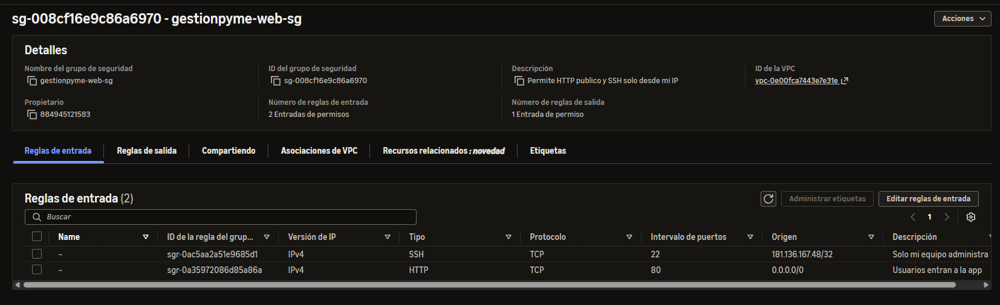
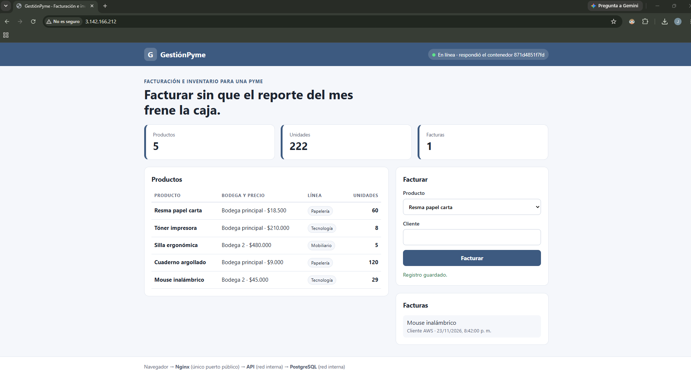
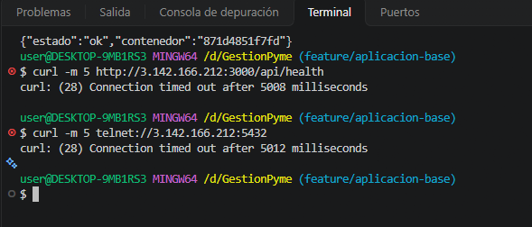
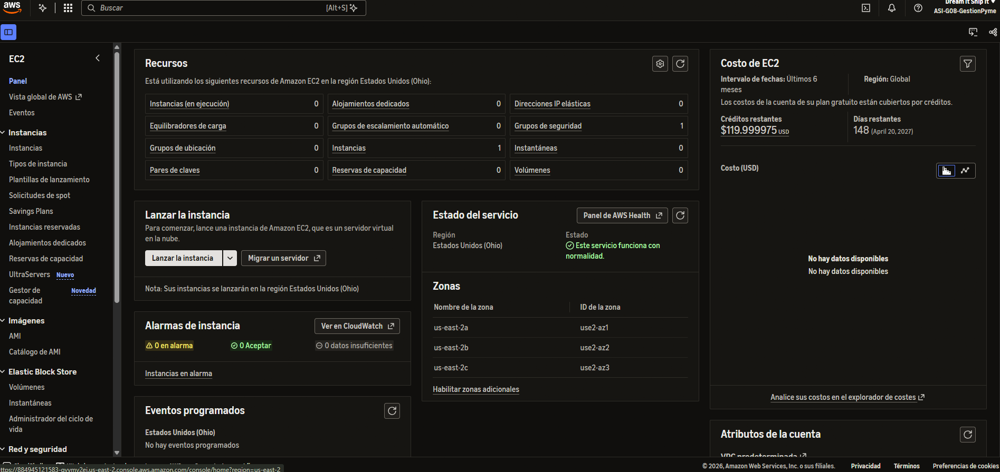
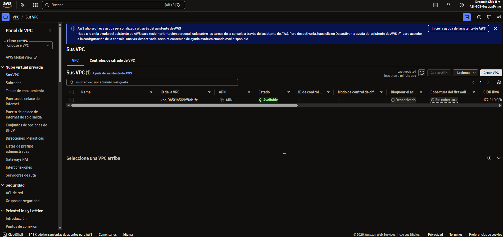

# Despliegue · GestiónPyme

Evidencia de que GestiónPyme corre **en local** y **en AWS** con la red segmentada, y de que la API y la base no son alcanzables desde internet.

- **Fecha del despliegue:** 23-nov-2026
- **Responsables:** Grupo 6
- **Requisitos que verifica:** RNF-05 (seguridad: aislamiento de la API y la base). Ver [rnf.md](rnf.md).

---

## 1. Qué se despliega

Los mismos tres contenedores, con el mismo `docker-compose.yml`, en el computador y en la nube:

| Servicio | Imagen | Redes | Puerto publicado |
|---|---|---|---|
| `proxy` | `nginx:1.27-alpine` | `publica`, `aplicacion` | **80** (8080 en local) |
| `api` | `gestionpyme-api:1.0` (Node.js 24, multi-stage, usuario no root) | `aplicacion`, `datos` | ninguno |
| `db` | `postgres:17-alpine` + volumen `datos` | `datos` | ninguno |

La configuración sensible (`DB_PASSWORD`) va en un `.env` que **nunca** se sube al repositorio: está en `.gitignore` y solo se versiona `.env.example`.

---

## 2. Ejecución en local

```bash
cp .env.example .env          # y cambiar DB_PASSWORD
docker compose up -d --build
docker compose ps             # api y db en (healthy)
```

Aplicación en `http://localhost:8080`, con una factura registrada por el equipo:



### Pruebas de aislamiento en local

| # | Prueba | Resultado esperado | Resultado obtenido |
|---|---|---|---|
| 1 | `curl -i http://localhost:8080/api/health` | `200 OK` | ✅ `200 OK`, `"estado":"ok"` |
| 2 | `curl -m 3 http://localhost:3000/api/health` | Falla | ✅ `Failed to connect` |
| 3 | `docker compose port api 3000` y `db 5432` | Sin puerto | ✅ `:0` en los dos |
| 4 | `docker compose exec proxy wget -qO- http://api:3000/api/health` | Responde | ✅ `{"estado":"ok"...}` |
| 5 | `docker compose exec proxy nc -zv -w 3 db 5432` | Falla | ✅ `bad address 'db'` |
| 6 | `docker compose exec api wget -qO- -T 5 https://example.com` | Falla | ✅ `bad address 'example.com'` |



---

## 3. Despliegue en AWS

Todo se hizo con el **usuario IAM** del integrante (nunca con el usuario raíz) y con las etiquetas `Proyecto = ASI-G06-GestionPyme` y `Owner = <integrante>`.

### 3.1 Recursos creados

| Recurso | Nombre | Configuración |
|---|---|---|
| Región | — | **us-east-2 (Ohio)**, la región habilitada en la cuenta del curso |
| VPC | `gestionpyme-vpc` | `10.0.0.0/16`, 1 zona, 1 subred pública, 1 privada, **sin NAT**, sin endpoints |
| Grupo de seguridad | `gestionpyme-web-sg` | Entrada: 80 desde `0.0.0.0/0`, 22 desde la IP del administrador |
| Par de llaves | `kp-gestionpyme` | RSA `.pem`, guardada **fuera** del repositorio |
| Instancia EC2 | `gestionpyme-web` | `t3.micro`, Ubuntu 24.04 LTS, subred pública, IP pública automática, 10 GiB gp3, *user data* `infra/nube/user-data.sh` |

El plan de red completo está en [arquitectura/red.md](arquitectura/red.md).

Mapa de recursos de la VPC:



Reglas de entrada del grupo de seguridad (solo 80 y 22; ni 3000 ni 5432):



### 3.2 Pasos

```bash
# En el computador, desde la raíz del repositorio (Git Bash)
tar -czf app.tgz docker-compose.yml .env.example src infra
scp -i <ruta>/kp-gestionpyme.pem app.tgz ubuntu@IP-PUBLICA:~
ssh -i <ruta>/kp-gestionpyme.pem ubuntu@IP-PUBLICA

# Dentro de la EC2
mkdir -p gestionpyme && tar -xzf app.tgz -C gestionpyme && cd gestionpyme
cp .env.example .env          # otra DB_PASSWORD y PUERTO_WEB=80
docker compose up -d --build
docker compose ps
```

Resultado de `docker compose ps` en la EC2: `api` y `db` en *healthy*; solo el `proxy` tiene `0.0.0.0:80->80/tcp`, mientras que `api` (3000/tcp) y `db` (5432/tcp) no están publicados.

Aplicación respondiendo en la IP pública:



### 3.3 Pruebas de aislamiento desde internet

Desde el computador del equipo, **no** desde el servidor:

| Prueba | Resultado esperado | Resultado obtenido |
|---|---|---|
| `curl -i http://IP-PUBLICA/api/health` | `200 OK` | ✅ `{"estado":"ok",...}` |
| `curl -m 5 http://IP-PUBLICA:3000/api/health` | Falla | ✅ `Connection timed out after 5008 ms` |
| `curl -m 5 telnet://IP-PUBLICA:5432` | Falla | ✅ `Connection timed out after 5012 ms` |



**Conclusión: se cumple la parte de aislamiento del RNF-05 (seguridad).** Desde internet solo responde el puerto 80. El porqué de las dos barreras (grupo de seguridad y puertos no publicados) está en [red.md, sección 6](arquitectura/red.md#6-las-dos-barreras).

---

## 4. Limpieza de recursos

Para no generar costos, al terminar se eliminaron:

1. La instancia `gestionpyme-web` (estado **Terminada**).
2. La VPC `gestionpyme-vpc`, con sus subredes, el Internet Gateway, las tablas de rutas y el grupo de seguridad.
3. (Opcional) El par de llaves `kp-gestionpyme`.





**Costo de la práctica:** la instancia estuvo encendida menos de una hora; con `t3.micro` (unos 0,01 USD/h) más la IP pública (0,005 USD/h), el costo es de unos centavos de dólar.

---

## 5. Problemas encontrados y cómo se resolvieron

| Problema | Causa | Solución |
|---|---|---|
| La consola solo mostraba recursos en **Ohio** | La cuenta del curso tiene habilitada `us-east-2` | Se desplegó en `us-east-2` (el manual solo *sugiere* `us-east-1`) |
| El nombre `sg-gestionpyme-web` fue rechazado | AWS reserva el prefijo `sg-` para los identificadores | Se usó `gestionpyme-web-sg` |
| El asistente de VPC proponía 2 zonas, 4 subredes y un endpoint de S3 | Valores por defecto del asistente | Se ajustó a 1 zona, 1 pública, 1 privada, sin NAT y sin endpoints |
| La AMI por defecto era Ubuntu 26.04 | AWS propone la versión más nueva | Se eligió Ubuntu 24.04 LTS, como indica el manual |
| `ls ~/kp-gestionpyme.pem` no encontraba la llave en Windows | La carpeta de usuario estaba en otro disco | Se usó la ruta completa de la llave en `scp` y `ssh` |

---

## 6. Para la demo del parcial

Para volver a levantarlo en vivo se repiten las secciones 3.1 y 3.2 (unos 20 minutos) y luego las pruebas de la sección 3.3. **Al terminar la demo se repite la sección 4.**
