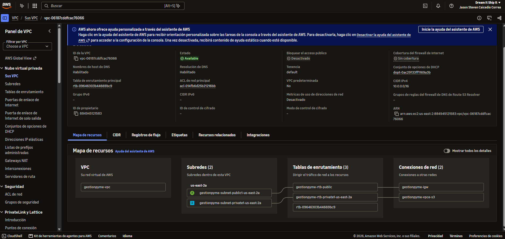
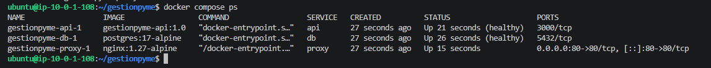
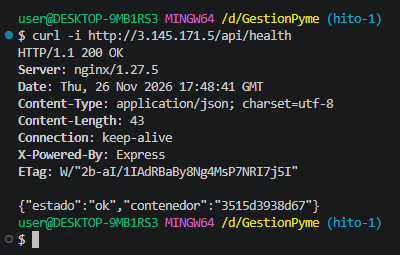
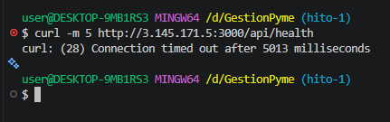
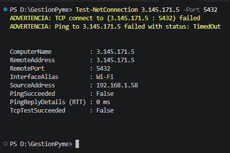
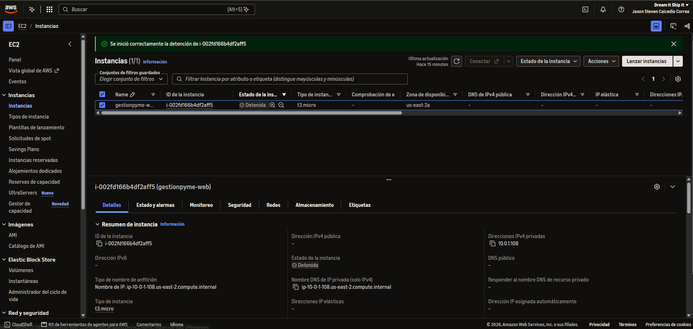

# Despliegue en AWS

- **Región:** us-east-2 (Ohio). La plantilla del curso sugiere `us-east-1`, pero la cuenta del curso solo tiene habilitada `us-east-2`.
- **Fecha del despliegue:** 2026-11-26
- **Recursos:** `gestionpyme-vpc`, `gestionpyme-web-sg`, `gestionpyme-web` (t3.micro), par de llaves `kp-gestionpyme`
- **Estado actual:** **detenida** (la IP pública cambia cada vez que se enciende)
- **Requisito que verifica:** RNF-05 (seguridad: la API y la base no son alcanzables desde internet). Ver [rnf.md](rnf.md).

> El grupo de seguridad se llama `gestionpyme-web-sg` y no `sg-gestionpyme-web` porque AWS no permite nombres que empiecen por `sg-`.

## Arquitectura de despliegue

Fuente editable: [arquitectura/despliegue.drawio](arquitectura/despliegue.drawio). El plan de red, con las rutas y la justificación de cada regla, está en [arquitectura/red.md](arquitectura/red.md).

| Recurso | Configuración |
|---|---|
| VPC `gestionpyme-vpc` | `10.0.0.0/16`, 1 zona (us-east-2a), 1 subred pública (`10.0.0.0/20`), 1 privada (`10.0.128.0/20`), **sin NAT Gateway**, sin endpoints |
| Internet Gateway `gestionpyme-igw` | Asociado solo a la tabla de rutas de la subred pública (`0.0.0.0/0 → igw`) |
| Instancia `gestionpyme-web` | `t3.micro`, Ubuntu 24.04 LTS, subred pública, IP pública automática, 10 GiB gp3 |
| *User data* | [`infra/nube/user-data.sh`](../infra/nube/user-data.sh): instala Docker y Docker Compose al arrancar |
| Contenedores | `proxy` (Nginx, publica 80), `api` (Node.js, 3000 sin publicar), `db` (PostgreSQL 17, 5432 sin publicar, volumen `datos`) |
| Etiquetas | `Proyecto = ASI-G06-GestionPyme`, `Owner = <integrante>` |

## Grupo de seguridad

| Tipo | Puerto | Origen | Justificación |
|---|---|---|---|
| HTTP | 80 | 0.0.0.0/0 | Los usuarios (administrador, vendedores, contador) entran a la aplicación por el proxy Nginx |
| SSH | 22 | IP del administrador (`/32`) | Solo el equipo administra el servidor; nadie más puede intentar conectarse |
| — | 3000 | *ninguna regla* | La API no debe ser alcanzable desde internet: solo el proxy habla con ella por la red Docker `aplicacion` |
| — | 5432 | *ninguna regla* | La base de datos no debe ser alcanzable desde internet: solo la API habla con ella por la red Docker `datos` |

**Salida:** todo el tráfico (la regla predeterminada), para instalar Docker y descargar las imágenes.

## Prueba de aislamiento

Las pruebas se hicieron el 26-nov-2026 **desde el computador del equipo**, no desde el servidor, contra la IP pública `3.145.171.5`, que es visible en cada captura.

| Prueba | Resultado esperado | Resultado obtenido | Captura |
|---|---|---|---|
| `curl -i http://IP/api/health` | 200 OK | ✅ `HTTP/1.1 200 OK` · `{"estado":"ok","contenedor":"3515d3938d67"}` | [prueba-health.png](despliegue/prueba-health.png) |
| `curl -m 5 http://IP:3000/api/health` | timeout | ✅ `curl: (28) Connection timed out after 5013 milliseconds` | [prueba-3000.png](despliegue/prueba-3000.png) |
| `Test-NetConnection IP -Port 5432` (PowerShell) | `TcpTestSucceeded : False` | ✅ `TcpTestSucceeded : False` | [prueba-5432.png](despliegue/prueba-5432.png) |

**Por qué fallan el 3000 y el 5432:** hay dos barreras independientes. El grupo de seguridad no tiene regla para esos puertos, y Docker no los publica (no tienen `ports:` en el `docker-compose.yml`). Si una falla, la otra sigue protegiendo. Ver [red.md, sección 6](arquitectura/red.md#6-las-dos-barreras).

## Evidencia

- Resource map de la VPC: 
- `docker compose ps` en la EC2 (solo el proxy publica un puerto): 
- `curl` a `/api/health` → 200: 
- `curl` al puerto 3000 → timeout: 
- `Test-NetConnection` al puerto 5432 → False: 
- Instancia detenida: 

Además, el 26-nov-2026 se probó **encender** la instancia: recibió la IP nueva `18.217.203.170` (la del despliegue era `3.145.171.5`), la aplicación abrió con sus datos intactos y luego se **detuvo** otra vez. Esto confirma que la IP pública cambia en cada encendido y que el volumen `datos` conserva las facturas.

## Costo

Precios de referencia por hora: `t3.micro` 0,0104 USD, IPv4 pública 0,005 USD y disco gp3 0,08 USD por GB al mes. Verificar en la [calculadora de AWS](https://calculator.aws/) para us-east-2.

| Escenario | Cálculo | Costo mensual estimado |
|---|---|---|
| **Encendida 24/7** | EC2 7,59 + IPv4 3,65 + disco 10 GB 0,80 | **≈ 12,04 USD** |
| **Encendida solo en horario** (7:00 a 21:00, 420 h) | EC2 4,37 + IPv4 2,10 + disco 0,80 | **≈ 7,27 USD** |
| **Detenida** | Solo el disco 10 GB (la IP pública se libera al detenerla) | **≈ 0,80 USD** |
| Arquitectura completa planeada (Opción A de la [cotización](estimacion/cotizacion-aws-gestionpyme.pdf)) | t3.medium + disco + IP + S3 | 21,04 USD |

**Comparación con el RNF-09 (techo de 25 USD/mes):** todos los escenarios están por debajo del techo. Incluso con la arquitectura completa (2 réplicas, Redis, worker y observabilidad) quedan unos 4 USD de margen.

**Gasto real de la cuenta (Billing → Bills):** **0,01 USD** en el mes actual (consultado el 26-nov-2026). La cuenta del curso muestra **119,99 USD de créditos restantes** y 147 días de vigencia (hasta el 20-abr-2027).

## Ejecución en local

Antes de AWS se probó en el computador con `docker compose up -d --build` en `http://localhost:8080`. Las 6 pruebas de aislamiento locales pasaron:

| # | Prueba | Resultado |
|---|---|---|
| 1 | `curl -i http://localhost:8080/api/health` | ✅ `200 OK` |
| 2 | `curl -m 3 http://localhost:3000/api/health` | ✅ `Failed to connect` |
| 3 | `docker compose port api 3000` y `db 5432` | ✅ `:0` (no publicados) |
| 4 | `docker compose exec proxy wget -qO- http://api:3000/api/health` | ✅ responde |
| 5 | `docker compose exec proxy nc -zv -w 3 db 5432` | ✅ `bad address 'db'` |
| 6 | `docker compose exec api wget -qO- -T 5 https://example.com` | ✅ `bad address` |

Capturas: [aplicación en local](../evidencias/captura1-local.png) · [pruebas locales](../evidencias/captura2-aislamiento-local.png).

## Cómo volver a levantarla (clase del 1-dic y parcial del 8-dic)

1. **EC2 → Instancias → `gestionpyme-web` → Estado de la instancia → Iniciar instancia.**
2. Copiar la **nueva IP pública** y abrir `http://IP-NUEVA`. Los contenedores tienen `restart: unless-stopped`, así que arrancan solos con Docker.
3. Si el SSH no conecta porque cambió la IP de la casa o la universidad: editar la regla 22 del grupo de seguridad y elegir **Mi IP** otra vez.
4. Al terminar: **Estado de la instancia → Detener instancia.** No *terminar*.

## Historial y problemas encontrados

| Situación | Qué se hizo |
|---|---|
| El 23-nov se desplegó y luego **se eliminó todo** siguiendo la parte F del manual | El taller pide dejar la instancia **detenida** y la VPC creada, así que se volvió a desplegar y se dejó detenida |
| La consola solo mostraba recursos en Ohio | Se usó `us-east-2`, la región habilitada en la cuenta del curso |
| El nombre `sg-gestionpyme-web` fue rechazado | AWS reserva el prefijo `sg-`; se usó `gestionpyme-web-sg` |
| El asistente de VPC proponía 2 zonas, 4 subredes y un endpoint de S3 | Se ajustó a 1 zona, 1 subred pública, 1 privada, sin NAT y sin endpoints |
| La AMI propuesta era Ubuntu 26.04 | Se eligió Ubuntu 24.04 LTS, como indica el manual |
